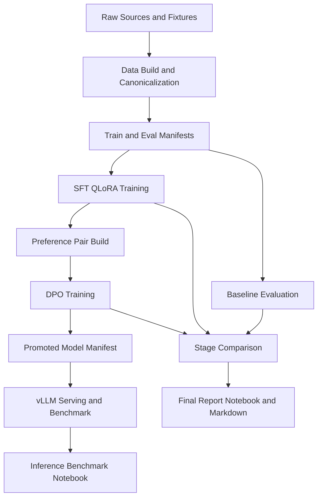

# TicketParse

[](pyproject.toml)
[](#)
[](#)
[](#)

LLM post-training pipeline for **schema-constrained support-ticket JSON extraction**,
running **baseline -> SFT (QLoRA) -> DPO -> inference benchmarking**.

---

## Architecture



Execution logic lives in `src/` and `scripts/`. Notebooks are for analysis and
reporting.

### Components

- **Data:** schema-first extraction contract, canonical data pipeline with source
  adapters and provenance tracking, and deterministic checks before model runs.
- **Training:** staged baseline -> SFT -> DPO workflow, with preference quality gates
  to avoid low-signal DPO training.
- **Evaluation:** syntax and semantic correctness scored separately, with diagnostics,
  hallucination tracking, and field-level metrics.
- **Serving:** vLLM with target resolution and LoRA support, config sweeps, and
  benchmark checkpoints that can resume after a Colab disconnect.
- **Storage:** the repo holds source and small artifacts. Runtime outputs live in
  Google Drive.

---

## Results

| Stage | JSON Validity | Schema Pass | Micro F1 | Macro F1 | Mean Latency (ms) |
| --- | ---: | ---: | ---: | ---: | ---: |
| Baseline | 0.9998 | 0.9876 | 0.3030 | 0.3008 | 10760.63 |
| SFT | 0.9990 | 0.8492 | 0.7334 | 0.6519 | 10773.13 |
| DPO | 0.9984 | 0.9982 | 0.7730 | 0.6871 | 16000.42 |

- **Baseline -> SFT:** primary semantic jump.
- **SFT -> DPO:** schema pass recovers, with an additional semantic gain.
- **Cost of DPO:** materially higher latency.

Source metrics:
- `artifacts/metrics/baseline-qwen2.5-1.5b_metrics.json`
- `artifacts/metrics/sft-full-colab_eval_metrics.json`
- `artifacts/metrics/dpo-full-colab_eval_metrics.json`

Reports:
- [`artifacts/reports/final_project_report.md`](artifacts/reports/final_project_report.md)
- [`artifacts/reports/dpo-full-colab_comparison_comparison_report.md`](artifacts/reports/dpo-full-colab_comparison_comparison_report.md)

---

## Tech Stack

- **Language/Runtime:** Python 3.11+
- **Modeling:** Transformers, TRL, PEFT, bitsandbytes (QLoRA)
- **Training:** SFTTrainer, DPOTrainer
- **Validation:** Pydantic schema contracts
- **Serving:** vLLM (OpenAI-compatible API, LoRA serving)
- **Evaluation:** deterministic metrics, diagnostics, and stage comparison
- **Workflow:** Colab runtime with Google Drive persistence

---

## Repository Layout

```text
ticketparse/
├── configs/               # Data, train, eval, and inference contracts
├── scripts/               # CLI entrypoints for pipeline stages
├── src/ticketparse/       # Reusable package modules
├── tests/                 # Deterministic test coverage
├── notebooks/             # Orchestration/review notebooks
├── data/                  # Manifests + fixtures
├── artifacts/             # Saved small metrics/plots/reports/checkpoint metadata
└── Makefile               # Local and Drive sync workflow helpers
```

---

## Running It

### 1) Local development

```bash
python3 -m venv .venv
source .venv/bin/activate
python -m pip install --upgrade pip
python -m pip install -e ".[dev]"
```

### 2) Drive-backed Colab flow

Set `LOCAL_GOOGLE_DRIVE_ROOT` to your own Google Drive folder:

```bash
make drive-init LOCAL_GOOGLE_DRIVE_ROOT="/path/to/your/Drive"
make drive-push-source LOCAL_GOOGLE_DRIVE_ROOT="/path/to/your/Drive"
```

Then in Colab:
1. run `notebooks/00_colab_setup.ipynb`
2. build manifests (`scripts/build_dataset_manifests.py --profile full`)
3. run stage notebooks/scripts (baseline, SFT, preference, DPO, compare)
4. run benchmark (`scripts/benchmark_vllm.py`)

Pull small artifacts back:

```bash
make drive-pull-artifacts LOCAL_GOOGLE_DRIVE_ROOT="/path/to/your/Drive"
```

---

## Inference Benchmarking

- promptset generation: `scripts/build_benchmark_promptsets.py`
- health checks: `scripts/check_vllm_health.py`
- benchmark orchestration: `scripts/benchmark_vllm.py`
- report rendering: `scripts/render_benchmark_report.py`
- analysis: `notebooks/07_vllm_benchmark_lab.ipynb`

Each benchmark run bundle is written to runtime storage:
`ticketparse-runs/persistent/benchmark/<run_name>/bundle.json`

---

## Not Included

- Model weights and checkpoints
- Full raw external datasets
- Saved serving benchmark results
